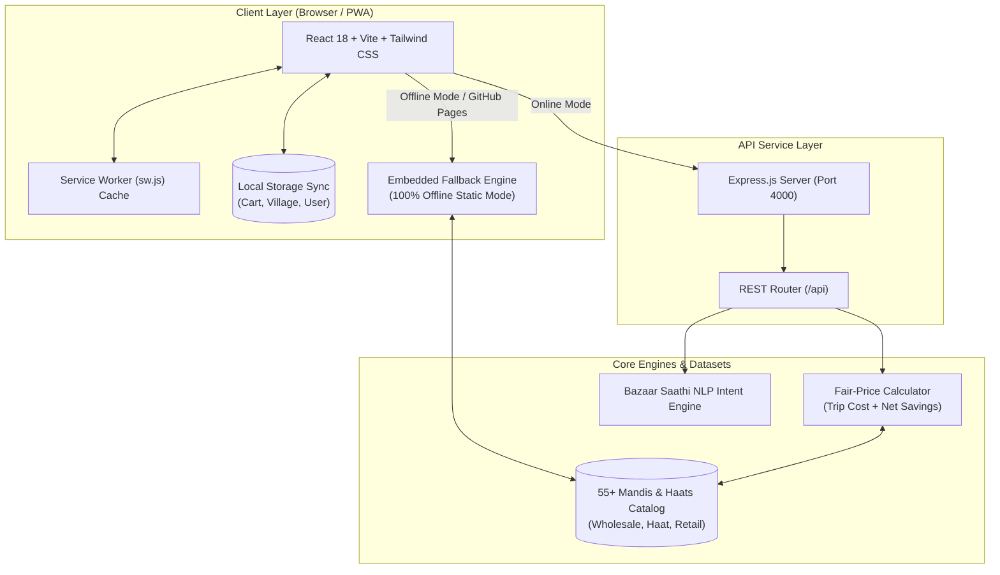

# KharidoSmart (खरीदो-स्मार्ट) 🌾🛒

<p align="center">
  
  
  
  
  
  
</p>

<p align="center">
  <strong>"अपने बाज़ार को जानिए, सही दाम पर खरीदिए।"</strong><br>
  <em>"Know your markets, purchase at the right price."</em>
</p>

<p align="center">
  <a href="https://avishrey-beep.github.io/Kharido-Smart/"><strong>🌐 Launch Live Web Application »</strong></a>
  <br>
  <a href="#-key-features">Features</a> •
  <a href="#-haatpata-design-system">Design System</a> •
  <a href="#-system-architecture">Architecture</a> •
  <a href="#-mathematical-fair-price-formulation">Pricing Formula</a> •
  <a href="#-getting-started">Getting Started</a> •
  <a href="#-automated-testing-suites">Testing</a> •
  <a href="#-documentation">Docs</a> •
  <a href="#-hackathon-demo-walkthrough">Demo Walkthrough</a>
</p>

---

## 📖 Overview

**KharidoSmart (खरीदो-स्मार्ट)** is an AI-powered rural commerce discovery, fair-price comparison, and shopping assistant specifically engineered for farmers, rural families, and residents of small towns across India.

In rural and semi-urban India, buyers often travel between weekly village haats (*साप्ताहिक हाट*), wholesale APMC mandis (*थोक मंडी*), and local retail bazaars (*खुदरा बाज़ार*). However, transport costs (bus fare, auto rickshaw, petrol) often wipe out the savings made by purchasing cheaper goods at distant mandis.

**KharidoSmart solves this information and transit asymmetry:**
1. Calculates the **Total Economic Trip Cost** (Goods Cost + Round-Trip Transit Fare) to recommend the true cheapest market.
2. Operates **100% offline** with Service Worker PWA caching and client-side database fallback for spotty rural connectivity.
3. Provides an interactive bilingual AI chatbot—**Bazaar Saathi (बाज़ार साथी)**—to guide buyers in Hindi and Hinglish.
4. Produces transparent **Itemized Mandi Receipts ("पक्की पर्ची")** with one-tap print/save and instant WhatsApp list sharing.

---

## 🌐 Live Application & Progressive Web App (PWA)

- **Production Live URL:** [https://avishrey-beep.github.io/Kharido-Smart/](https://avishrey-beep.github.io/Kharido-Smart/)
- **Mobile PWA Ready:** Open the link in Chrome/Safari on Android or iOS and select **"Add to Home Screen"** or **"Install App"** to use KharidoSmart as an offline native application.
- **Offline Resilience:** Previously viewed mandis and current shopping lists remain fully interactive without internet connection.

---

## 🌟 Key Features

### 1. 🛒 Smart Shopping List & Split-Screen Workspace
- **2-Column Split-Screen Layout:** Engineered for desktop screens (up to `1400px` max-width) while adapting to single-column on mobile.
  - **Left Panel:** Category selection, live item search, bilingual staple chips, quantity steppers, and quick-add actions.
  - **Right Panel:** Real-time Shopping Bag (*आपकी झोली*) displaying item counts, subtotal estimates, clear actions, and direct market comparison triggers.
- **Bilingual Commodity Search:** Search staples in Hindi or English (e.g., *Atta / आटा*, *Mustard Oil / सरसों का तेल*, *Potatoes / आलू*).
- **1-Tap Quick Staples:** Add everyday kitchen essentials in a single click.
- **WhatsApp & Clipboard Sharing:** One-tap export of your curated shopping list formatted with Hindi item names, quantities, and estimated subtotal for family or village groups.

### 2. ⚖️ Fair-Price Comparison Engine (55+ Mandis)
- Analyzes catalog of **55+ procedurally generated and curated mandis**, weekly village haats, and retail shops.
- Calculates true trip economics: evaluates distance, transit costs, and wholesale vs. retail price modifiers per commodity category.
- Awards a prominent **`★ BEST PRICE (सबसे सस्ता)`** badge to the market offering maximum net savings.
- Real-time search and filtering by market category:
  - **Wholesale Mandis** (*थोक मंडी*)
  - **Weekly Haats** (*साप्ताहिक हाट*)
  - **Retail Bazaars** (*खुदरा बाज़ार*)
  - **Open Now** (*अभी खुला है*)

### 3. 🧾 Itemized Mandi Receipt Inspector ("पक्की पर्ची")
- Inspect an authentic **Itemized Breakdown Modal** for any mandi before traveling:
  - Item-by-item commodity prices, quantities, and line-item totals.
  - Goods Subtotal (*सामान का कुल मूल्य*).
  - Round-trip transit & travel fare (*यातायात / किराया*).
  - Net Grand Total (*अनुमानित कुल खर्च*).
  - Speciality notes & operating hours.
  - **Print / Save (`प्रिंट करें`) Button:** Print physical receipts or save PDF snapshots.

### 4. 🤖 Bazaar Saathi (AI Rural Shopping Assistant)
- Persistent floating companion accessible across all screens.
- Understands colloquial Hinglish and Hindi queries:
  - *"Aata kahan sasta milega?"* ➔ Points to Kisan Mandi Sadar wholesale rates.
  - *"Mangalwar Haat kab khulta hai?"* ➔ Details opening timings and clothing discounts.
  - *"Sabse nazdeek bazaar kaun sa hai?"* ➔ Directs to nearest local retail center.

### 5. 🔐 Rural-First Onboarding & Authentication
- **Default "Create Account First":** Welcomes new village users directly to registration.
- **1-Tap Google Sign-In:** Instant authentication with official Google provider button.
- **Dual Password Security:** "New Password" and "Rewrite Password" fields with real-time match validation.
- **Strict Indian Mobile Validation:** Enforces 10-digit mobile number input with polite, immediate error handling: `"Fault: You have to write 10 digits only"`.
- **Village Customization:** Allows users to select or enter their home village (e.g., *Sadar Village*, *Kalyanpur*, *Mangalwar Haat*, *Rampur*) for accurate transit calculations.

---

## 🎨 HaatPata Neo-Brutalist Design System

KharidoSmart utilizes a custom **HaatPata Neo-Brutalist** aesthetic tailored for high-glare outdoor sunlight conditions in rural environments:

| Token / Role | Hex Code | Visual Swatch | Purpose |
|:---|:---|:---:|:---|
| **Warm Cream** | `#FBF6EA` | `██████` | High-contrast background reducing battery strain and screen glare |
| **Terracotta Red** | `#A24A32` | `██████` | Primary CTA, best-price badges, and critical trip alerts |
| **Mustard Gold** | `#E3A83B` | `██████` | Badges, highlighted chips, ratings, and secondary accents |
| **Forest Leaf Green** | `#4B6142` | `██████` | Navigation buttons, positive savings indicators, and success states |
| **Dark Earth** | `#2B2118` | `██████` | Heavy 2px–3px solid borders, hard drop-shadows (`shadow-[3px_3px_0_#2B2118]`), and bold typography |

---

## 📐 Mathematical Fair-Price Formulation

Unlike standard e-commerce platforms that only compare unit prices, KharidoSmart accounts for spatial economics and transit friction.

For a shopping list of $N$ items and a candidate market $M$:

$$\text{TripCost}(M) = \sum_{i=1}^{N} \Big(\text{Round}\big(\text{BasePrice}_i \times \text{PriceModifier}_{M, \text{Category}(i)}\big) \times \text{Quantity}_i\Big) + \text{TravelCost}_M$$

Where:
- $\text{BasePrice}_i$: Benchmark retail price for commodity $i$.
- $\text{PriceModifier}_{M, C}$: Market-specific category multiplier ($0.75 - 1.25$):
  - Wholesale mandis apply lower multipliers ($0.80 - 0.85\times$) for agricultural staples.
  - Retail shops apply convenience markups ($1.10 - 1.20\times$) with zero travel cost.
- $\text{TravelCost}_M$: Round-trip transit cost (bus fare, auto, tempo) based on distance from the user's registered village.
- $\text{NetSavings}$: Difference between local retail cost and the optimal market trip cost:

$$\text{NetSavings} = \text{TripCost}(\text{LocalRetail}) - \min_{M}(\text{TripCost}(M))$$

A distant wholesale market is only ranked **#1** if the bulk commodity savings exceed the round-trip travel expenditure.

---

## 🏗️ System Architecture



---

## 📂 Project Directory Structure

```text
KharidoSmart/
├── .github/                      # GitHub issue templates and workflow configs
├── backend/                      # Express.js REST API service
│   ├── node_modules/             # Backend dependencies
│   ├── package.json              # Express, CORS, testing scripts
│   ├── server.js                 # REST endpoints (/api/categories, /products, /markets, /compare, /chat)
│   └── test-engine.js            # Automated test suite for backend logic (4/4 passing)
├── docs/                         # Production GitHub Pages deployment & developer guides
│   ├── assets/                   # Compiled CSS & JS bundles with content hashing
│   ├── 404.html                  # Single-Page-App routing fallback for GitHub Pages
│   ├── .nojekyll                 # Bypasses Jekyll processing on GitHub Pages
│   ├── API.md                    # Comprehensive REST API specifications
│   ├── ARCHITECTURE.md           # System design & algorithmic documentation
│   ├── index.html                # Compiled production application entry
│   ├── manifest.json             # PWA web manifest
│   └── sw.js                     # Offline Service Worker cache bundle
├── frontend/                     # React 18 + Vite client application
│   ├── public/                   # Static PWA assets, icons, service worker
│   │   ├── favicon.ico
│   │   ├── manifest.json
│   │   └── sw.js
│   ├── src/                      # Application source code
│   │   ├── components/           # Reusable UI components
│   │   │   ├── BottomNav.jsx     # Sticky mobile navigation bar
│   │   │   ├── ChatbotFab.jsx    # Bazaar Saathi floating assistant & modal
│   │   │   └── TopBar.jsx        # Sticky header with village selector & Hindi toggle
│   │   ├── pages/                # Screen views
│   │   │   ├── Home.jsx          # Dashboard with quick staples & category cards
│   │   │   ├── Login.jsx         # Mobile-first auth with Google & dual password
│   │   │   ├── Markets.jsx       # 55-mandi browser, search, filters, receipt modal
│   │   │   └── ShoppingList.jsx  # Split-screen list builder, steppers, WhatsApp share
│   │   ├── services/
│   │   │   └── api.js            # Dual-mode API client (REST + Offline Fallback)
│   │   ├── test/                 # Automated frontend testing suite
│   │   │   └── shopping.test.js  # Unit tests for validation, cart math & offline sync
│   │   ├── App.jsx               # Top-level routing and layout shell
│   │   ├── index.css             # Tailwind directives & HaatPata custom utilities
│   │   ├── main.jsx              # React DOM mounting & Service Worker registration
│   │   └── serviceWorkerRegistration.js # PWA lifecycle hooks
│   ├── index.html                # Vite HTML template
│   ├── package.json              # Frontend dependencies and test scripts
│   ├── tailwind.config.js        # Custom HaatPata color palette extensions
│   └── vite.config.js            # Vite build configuration
├── CONTRIBUTING.md               # Developer guidelines & rural UX standards
└── README.md                     # Project documentation & master overview
```

---

## 🚀 Getting Started & Local Development

### Prerequisites
- **Node.js**: v18.0.0 or higher
- **npm**: v9.0.0 or higher
- **Git**

### 1. Clone the Repository
```bash
git clone https://github.com/avishrey-beep/Kharido-Smart.git
cd Kharido-Smart
```

### 2. Setup & Run the Backend API
```bash
cd backend
npm install
npm test          # Run automated backend test suite
node server.js    # Starts API on http://localhost:4000
```

### 3. Setup & Run the Frontend Client
Open a new terminal window:
```bash
cd frontend
npm install
npm test          # Run automated frontend test suite
npm run dev       # Starts Vite dev server on http://localhost:5173
```

Open your browser at `http://localhost:5173` to explore the application locally.

---

## 🧪 Automated Testing Suites

Both frontend and backend include independent, zero-dependency automated unit test suites:

### 1. Frontend Test Suite (`frontend/test/shopping.test.js`)
Run command:
```bash
cd frontend && npm test
```
**Test Coverage (5/5 Passing):**
1. **Phone Validation & Fault Messages:** Strict 10-digit Indian mobile number validation, stripping non-numeric characters, and dual-password match verification.
2. **Shopping Cart Math:** Subtotal price summation across units (kg, litre, piece) and quantity clamping (flooring at zero).
3. **Mandi Fair-Price Comparator:** Verification that market ranking correctly accounts for travel cost and calculates net rupee savings.
4. **WhatsApp Formatter:** Proper formatting of bilingual shopping list strings with emojis, quantities, and direct web links.
5. **Offline Storage Serialization:** JSON serialization resilience and `localStorage` caching stability.

### 2. Backend Test Suite (`backend/test-engine.js`)
Run command:
```bash
cd backend && npm test
```
**Test Coverage (4/4 Passing):**
1. **Database Schema Integrity:** Validates category and product staple definitions.
2. **Procedural Market Generation:** Verifies scale generation of 52+ mandis with coordinates and modifiers.
3. **Fair-Price Cost Optimization:** Verifies lowest trip cost market is placed at rank #1.
4. **Chatbot Keyword Routing:** Verifies intent routing for Hindi queries (*sasta*, *haat*, *nazdeek*).

---

## 📚 Documentation & Technical Specifications

- [📖 REST API Specification (docs/API.md)](docs/API.md): Detailed documentation of all endpoints, request/response bodies, status codes, and dual-mode client fallback.
- [🏛️ System Architecture (docs/ARCHITECTURE.md)](docs/ARCHITECTURE.md): Mathematical formulations, architectural diagrams, and procedural data generation.
- [🤝 Contributing Guidelines (CONTRIBUTING.md)](CONTRIBUTING.md): Code of conduct, rural UX guidelines, conventional commit rules, and pull request procedures.

---

## 🎯 Hackathon & Demonstration Walkthrough

Follow these steps for an optimal demonstration to judges:

1. **Mobile Experience (Android/iOS View):**
   - Open [https://avishrey-beep.github.io/Kharido-Smart/](https://avishrey-beep.github.io/Kharido-Smart/) in Chrome.
   - Press `F12` and click the **Device Toolbar icon** (toggle to **Pixel 7** or **iPhone 14**).
   - Experience the fixed **"My Haat (मेरा हाट)"** header, native bottom navigation, and butter-smooth scrolling.
2. **Build a Rural Shopping List:**
   - Tap **"Bazaar List"** in the bottom bar.
   - Use the **1-Tap Quick Staples** to instantly add *Atta (आटा)* and *Potatoes (आलू)*.
   - Use the custom item picker to search for *Mustard Oil (सरसों का तेल)* and adjust quantities using the tactile stepper.
3. **WhatsApp Sharing:**
   - Click **"WhatsApp Share (व्हाट्सएप भेजें)"** to view the formatted message ready to send to family members.
4. **Run Fair-Price Comparison:**
   - Click **"Find My Best Market (सस्ता बाज़ार खोजें)"**.
   - Notice how the algorithm factors in transit fares from your selected village and crowns the `#1 Best Price` market.
5. **Inspect the Mandi Receipt ("पक्की पर्ची"):**
   - Tap the **"पर्ची (Receipt)"** button on any market card.
   - View the detailed table showing line-item goods cost, transit fare, and net grand total. Click **"Print / Save"**.
6. **Chat with Bazaar Saathi:**
   - Click the floating **Bazaar Saathi** lantern icon in the bottom-right corner.
   - Ask: *"Aata kahan sasta milega?"* or *"Haat kab khulta hai?"* to witness instant bilingual AI market advice.

---

## 🔮 Roadmap & Future Horizons

- [ ] **Agmarknet Live Mandi Integration:** Sync daily APMC commodity rates directly with Indian government data feeds.
- [ ] **Voice-First Regional Dialects:** Integrate Web Speech API with regional Indian dialect support (Bhojpuri, Maithili, Awadhi, Bundelkhandi).
- [ ] **Community Haat Crowdsourcing:** Allow local farmers and vendors to post today's haat arrival times and live vegetable rates.
- [ ] **Carpooling / Group Transit Matcher:** Connect neighboring villagers traveling to the same wholesale mandi to share tempo/rickshaw transit fares.

---

## 📄 License & Credits

This project is licensed under the **MIT License** — see the [LICENSE](LICENSE) file for details.

Developed with ❤️ for Indian Agriculture and Rural Empowerment by **[Shreyansh Srivastava](https://github.com/avishrey-beep)**.
